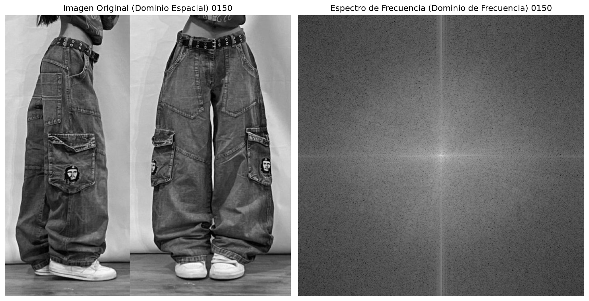
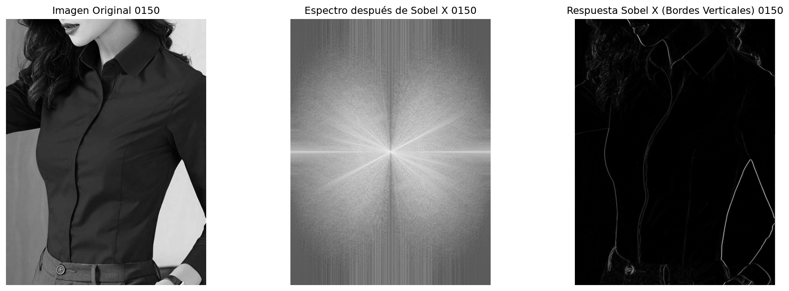
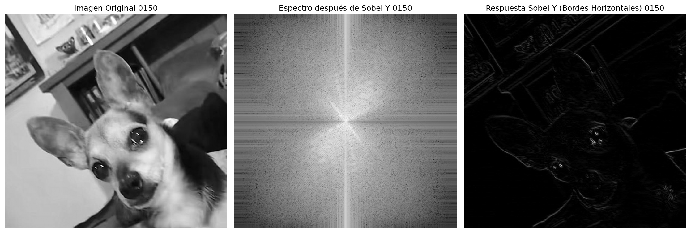
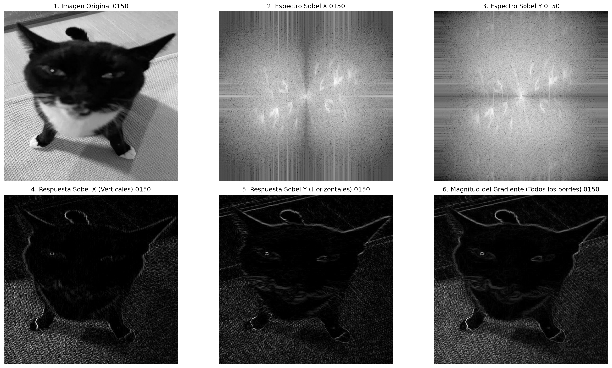

# Práctica guiada: Procesamiento de imágenes mediante filtros Sobel en el dominio de la frecuencia
## Nivel: Cero a principiante
## Duración: 2 horas

## Asignatura: Soluciona problemas de Visión Artificial
## Especialidad: Inteligencia Artificial
## Submódulo 3: Soluciona problemas de Visión Artificial
## Semestre: Tercer semestre de preparatoria
## IDE: Visual Studio Code
## Lenguaje: Python
## Librerías: OpenCV, NumPy, Matplotlib y Scikit-image
## Carpeta de trabajo: u3-p7-proce-img-img-0150
## Zavala Medina | NC= 0150

## Ejemplo 1: Cargar la imagen y visualizar su espectro

## Ejemplo 2: Aplicar el filtro Sobel X en el dominio de la frecuencia

## Ejemplo 3: Aplicar el filtro Sobel Y en el dominio de la frecuencia 

## Ejemplo 4: Calcular la magnitud del gradiente y comparar
